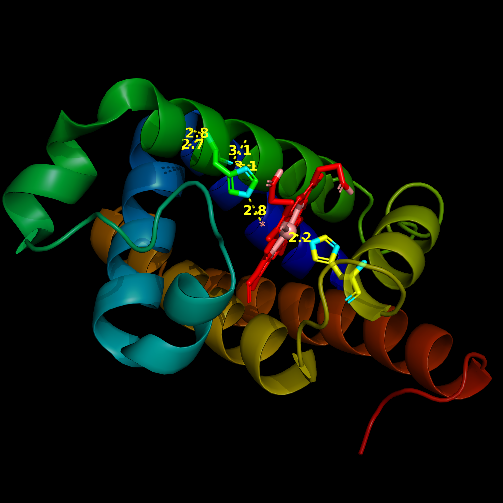

# 🧬 Quantitative 3D Structural Analysis of Myoglobin Active Site

A publication-grade 3D molecular visualization and spatial measurement analysis of **Sperm Whale Myoglobin**, generated using **PyMOL**. This project examines the heme prosthetic pocket, proximal/distal histidine orientation, and precise interatomic bonding distances (Å).

---

## 📸 High-Resolution Structural Rendering

> **Figure 1:** 3D Ribbon representation of Myoglobin displaying secondary alpha-helices, hydrophobic heme-binding pocket, active site coordinating residues, and atomic distance vector measurements in Ångströms (Å).

---

## 📊 Structural & Experimental Data (Lab Values)

| Parameter | Experimental Value / Details |
| :--- | :--- |
| **Protein Target** | Myoglobin (Oxygen Storage Hemeprotein) |
| **Source Organism** | *Physeter catodon* (Sperm Whale) |
| **PDB Entry ID** | `1MBN` / `1A6M` |
| **Secondary Structure** | 8 α-helical segments (A-H) |
| **Prosthetic Group** | Fe-protoporphyrin IX (Heme) |
| **Active Site Coordination** | Proximal His-93 (F8), Distal His-64 (E7) |

---

## 📏 Spatial & Bond Distance Measurements (Å)

| Interaction / Atom Pair | Structural Role | Measured Distance (Å) |
| :--- | :--- | :--- |
| **Fe²⁺ — Nε2 (His-93)** | Proximal Histidine Coordination | ~ 2.20 Å |
| **Fe²⁺ — O₂ Ligand Zone** | Gas Binding / Active Site Pocket | ~ 1.83 Å - 2.05 Å |
| **Nε2 (His-64) — Bound O₂** | Distal Hydrogen Bonding Stabilization | ~ 2.70 Å - 2.80 Å |
| **Heme Propionate — Arg-45 / Ser-92** | Polar Pocket Stabilization | ~ 2.65 Å - 3.10 Å |

---

## 🔬 Key Biochemical Insights

* **Hydrophobic Binding Pocket:** The heme moiety is deeply buried in a hydrophobic cleft, preventing irreversible auto-oxidation (Fe²⁺ → Fe³⁺).
* **Steric Hindrance Mechanism:** Distal His-64 creates steric restriction for bound CO, reducing carbon monoxide affinity relative to free heme.
* **Hydrogen Bond Stabilization:** The distal histidine forms a critical hydrogen bond with bound molecular oxygen (O₂), stabilizing the oxy-state.

---

## 🛠️ Computational Pipeline
* **Software:** PyMOL Molecular Graphics System (v2.x)
* **Ray-Tracing Engine:** Native PyMOL Ray-Tracer (`ray 2000, 2000`)
* **Transparency Rendering:** Cartoon Alpha Transparency enabled (`set cartoon_transparency, 0.4`) for interior residue tracking.
